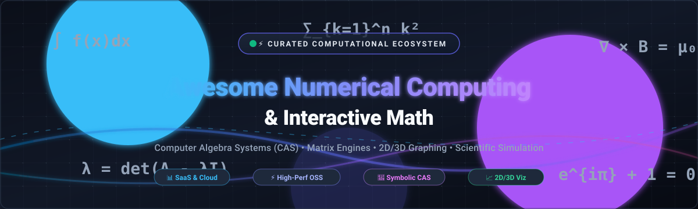

  

# 🚀 Awesome Numerical Computing & Interactive Math

  
  
  
  
  
  

> 🌟 A comprehensive, curated list of the best **Numerical Computing**, **Interactive Math**, **Computer Algebra Systems (CAS)**, and **Mathematical Visualization** platforms — featuring commercial SaaS/cloud software, free tier limits, corporate valuations, and open-source alternatives. 🌟

✨ Looking for high-performance matrix computation, interactive 2D/3D graphing, symbolic algebra engines, dynamic geometry, or browser-based technical computing? This guide benchmarks the top tools across industry, research, and STEM education.

---

## 📈 Sector Overview & Market Dynamics

The global numerical analysis and mathematical computing software market is valued at approximately **$13.5 billion to $14 billion** and is projected to expand toward **$35 billion** over the next decade at a compound annual growth rate (CAGR) of roughly **11–12%**. 

The sector exhibits a **hybrid market structure**:
- 🏢 **Enterprise & Industrial Tier (Highly Concentrated / Oligopoly):** Heavy-duty technical computing, multi-domain physical simulation, and industrial engineering remain deeply consolidated among legacy giants like MathWorks (MATLAB), Wolfram Research (Mathematica), and Maplesoft (Cybernet Systems). These platforms benefit from immense moats built on proprietary toolboxes, decades of legacy codebases, and institutional academic campus licensing.
- 🎓 **Academic, Consumer & Educational Math Tier (Moderately Fragmented to Winner-Take-All EdTech):** Consumer homework solvers and interactive classroom visualization have seen rapid consolidation through strategic acquisitions (e.g., Google acquiring Photomath for ~$550M, Chegg acquiring Mathway for ~$100M, Byju's acquiring GeoGebra for ~$100M, and Amplify acquiring Desmos' curriculum business). Meanwhile, browser-first interactive notebooks, modern JavaScript math engines, and scientific Python/Julia open-source ecosystems create a continuous, decentralized, and fragmented counterweight to commercial lock-in.

---

## 📋 Table of Contents

- [📈 Sector Overview & Market Dynamics](#-sector-overview--market-dynamics)
- [🟦 SaaS & Hosted Platforms](#-saas--hosted-platforms)
- [🟩 Open-Source Software & Libraries](#-open-source-software--libraries)
- [📊 Feature Comparison Matrix](#-feature-comparison-matrix)
- [⭐ Star History](#-star-history)
- [💖 Support & Community](#-support--community)
- [🤝 Contributing](#-contributing)
- [📄 License](#-license)

---

## 🟦 SaaS & Hosted Platforms

💼 Commercial, hosted, and cloud-first numerical computing and math software platforms, sorted in descending order by company size (valuation / annual revenue).

| Platform | Category / Use Case | Starting Price | Free Tier / Trial Limits | Company Size / Valuation |
|:---|:---|:---|:---|:---|
| **[Photomath](https://photomath.com/)** 📱 | Camera-based AI math problem solver & step-by-step assistant | **$9.99/mo** (Photomath Plus) or $69.99/yr | **Free forever with limits**: Unlimited equation solving, camera scanning, and step-by-step solutions for core math; animated tutorials and deep conceptual explanations require Plus | **~$550M Valuation** (Acquired by Google / Alphabet) 🏢 |
| **[MATLAB Online](https://www.mathworks.com/products/matlab-online.html)** ⚙️ | Cloud numerical computing, matrix algorithms & technical simulation | **$49/yr** (Student) / $149 perpetual (Home) / $860/yr or $2,150 perpetual (Standard) | **Free forever tier**: Max 20 hours/calendar month, 5 GB MATLAB Drive storage, 10 core toolboxes; or 30-day full-access trial | **~$1.5B Annual Revenue** (MathWorks, profitable private co.) 💼 |
| **[Desmos Studio](https://www.desmos.com/)** 📐 | Fast browser-based 2D graphing, geometry & scientific calculation | **Free for end users**; enterprise & publisher API curriculum licensing | **Free forever plan**: 100% free with unlimited graphs, sliders, classroom activities, and geometry tools; no ads or paid paywalls | **~$150M–$250M Est. Valuation** (Curriculum arm acquired by Amplify; Desmos Studio operates as Public Benefit Corp) 🏫 |
| **[Mathway](https://www.mathway.com/)** 🔢 | Step-by-step algebra, calculus & graphing math solver | **$9.99/mo** or $39.99/yr (Mathway Premium) | **Free forever tier**: Unlimited problem submissions and instant final answers/graphing; step-by-step explanations locked behind Premium | **~$100M Valuation** (Acquired by Chegg) 📚 |
| **[GeoGebra](https://www.geogebra.org/)** 🌐 | Dynamic mathematics, 2D/3D geometry, algebra & calculus software | **Free for non-commercial use**; commercial licensing on inquiry | **Free forever tier**: Full unconstrained access to Graphing, 3D Calculator, Geometry, CAS, and Suite apps for non-commercial & educational use | **~$100M Valuation** (Acquired by Byju's) 🎒 |
| **[Wolfram\|Alpha](https://www.wolframalpha.com/)** 🧠 | Natural-language computational knowledge engine & CAS | **$5.00/mo** (billed annually at $60/yr) or $9.99/mo (Pro) | **Free forever tier**: Unlimited standard computation and answers; step-by-step solutions, photo/file uploads (>2MB), and extended computation time locked | **~$70M+ Annual Revenue** (Wolfram Research, private co.) 🔬 |
| **[Symbolab](https://www.symbolab.com/)** 📝 | Interactive step-by-step math solver, graphing & practice calculator | **$6.99/mo** or $29.99/yr (Pro) | **Free forever tier**: Unlimited problem solving and final numerical/algebraic answers; full step-by-step breakdowns and practice quizzes locked | **~$50M–$75M Est. Valuation** (Acquired by Course Hero / Learneo) 🎓 |
| **[Maple Cloud](https://www.maplesoft.com/products/maple/)** 🍁 | Cloud-connected symbolic math and engineering calculation engine | **$75** (Student Desktop) / $289 (Academic/Personal) / commercial tiers | **Free trial**: 15-day free trial of desktop software; Maple Learn & MapleCloud web canvas have free tier with basic document sharing | **~$28M Annual Revenue** (Maplesoft, owned by Cybernet Systems) 📊 |

---

## 🟩 Open-Source Software & Libraries

🔓 Open-source numerical computing environments, computer algebra systems (CAS), and interactive visualization libraries. Sorted in descending order by GitHub stargazer count.

| Project | GitHub_Stars | Stack | License | Description & Key Strengths |
|:---|:---:|:---|:---|:---|
| **[Manim](https://github.com/3b1b/manim)** 🎬 |  | Python | MIT | Animation engine for explanatory math videos, created by Grant Sanderson (3Blue1Brown) for programmatic geometric and algebraic animation. |
| **[NumPy](https://github.com/numpy/numpy)** 🔢 |  | Python / C | BSD-3-Clause | The fundamental package for scientific computing with Python, providing N-dimensional arrays, linear algebra, Fourier transforms, and random numbers. |
| **[Julia](https://github.com/JuliaLang/julia)** 🚀 |  | Julia / C / C++ / LLVM | MIT | High-level, high-performance dynamic programming language specifically designed for technical, numerical, and scientific computing. |
| **[Matplotlib](https://github.com/matplotlib/matplotlib)** 📊 |  | Python / C++ | PSF-based | Comprehensive library for creating static, animated, and interactive mathematical visualizations and figures in Python. |
| **[Plotly.py](https://github.com/plotly/plotly.py)** 📈 |  | Python | MIT | Interactive graphing library for Python supporting scientific, 3D, statistical, and financial charts with WebGL acceleration. |
| **[Plotly.js](https://github.com/plotly/plotly.js)** 📉 |  | JavaScript | MIT | Open-source JavaScript graphing library powering Plotly, supporting over 40 interactive chart types and WebGL 3D math plots. |
| **[SciPy](https://github.com/scipy/scipy)** 🧪 |  | Python / C / Fortran | BSD-3-Clause | Fundamental algorithms for scientific computing in Python: numerical integration, differential equation solvers, optimization, and linear algebra. |
| **[SymPy](https://github.com/sympy/sympy)** 🔣 |  | Python | BSD-3-Clause | Full-featured computer algebra system (CAS) written entirely in Python, supporting calculus, algebraic solvers, discrete math, and quantum physics. |
| **[math.js](https://github.com/josdejong/mathjs)** ⚡ |  | JavaScript / TypeScript | Apache-2.0 | Extensive math library for JavaScript and Node.js featuring an expression parser, symbolic computation, matrix operations, and complex numbers. |
| **[MathJax](https://github.com/mathjax/MathJax)** 🖹 |  | JavaScript | Apache-2.0 | Open-source JavaScript display engine for LaTeX, MathML, and AsciiMath notation that works across all modern web browsers. |
| **[Math.NET Numerics](https://github.com/mathnet/mathnet-numerics)** 💻 |  | C# / F# (.NET) | MIT | The premier numerical library for .NET, C#, and F#, covering linear algebra, special functions, numerical integration, Fourier transforms, and statistics. |
| **[Breeze](https://github.com/scalanlp/breeze)** 🌪️ |  | Scala | Apache-2.0 | Numerical processing, machine learning, and linear algebra library for Scala, bringing NumPy-like expressive operations to the JVM. |
| **[SageMath](https://github.com/sagemath/sage)** 🌿 |  | Python / Cython / C | GPL-3.0 | The most comprehensive open-source CAS, integrating dozens of specialized packages (Maxima, Pari, GAP, FLINT, R) under a unified Python interface. |
| **[GeoGebra (Giac & Web Apps)](https://github.com/geogebra/geogebra)** 📐 |  | Java / TypeScript | GPL-3.0 / Non-Commercial | Open-source frontends and engines behind GeoGebra's dynamic mathematics, interactive 2D/3D geometry, and calculus tools. |
| **[Symbolics.jl](https://github.com/JuliaSymbolics/Symbolics.jl)** ⚛️ |  | Julia | MIT | Fast, modern computer algebra system (CAS) for Julia that integrates seamlessly with Julia's differential equation and SciML scientific ML ecosystems. |
| **[GNU Octave](https://github.com/gnu-octave/octave)** 🐙 |  | C++ / Octave | GPL-3.0 | High-level interpreted language for numerical computations, designed for drop-in script compatibility with MATLAB syntax and matrix arithmetic. |
| **[wxMaxima](https://github.com/wxMaxima-developers/wxmaxima)** 🖥️ |  | C++ / Lisp | GPL-2.0 | Document-based graphical user interface for the classic Maxima computer algebra system, providing 2D formula display and inline plotting. |
| **[Compute Engine (CortexJS)](https://github.com/cortex-js/compute-engine)** 🧩 |  | TypeScript | MIT | High-performance TypeScript math engine for parsing, evaluating, and manipulating symbolic LaTeX and MathJSON expressions in web browsers. |
| **[Symja](https://github.com/axkr/symja_android_library)** ☕ |  | Java | LGPL-3.0 / GPL-3.0 | Pure Java computer algebra and symbolic mathematics library for Android and JVM desktop applications. |
| **[Gnuplot](https://github.com/gnuplot/gnuplot)** 📊 |  | C | Open Source (Gnuplot License) | Portable, command-line driven interactive data and function plotting utility with support for 2D/3D visualizations, contours, and vector fields. |
| **[Calculus.jl](https://github.com/JuliaMath/Calculus.jl)** 📜 |  | Julia | MIT | Pure Julia library providing symbolic and numerical differentiation, univariate root-finding, and integration algorithms. |
| **[Mathomatic](https://github.com/mfillpot/mathomatic)** ⚙️ |  | C | LGPL-2.1 | Lightweight, portable CAS written in ANSI C that solves, simplifies, differentiates, and generates C/Python code from mathematical equations. |
| **[Xcas / Giac](https://github.com/geogebra/giac)** 🔍 |  | C++ | GPL-3.0 | Robust C++ computer algebra engine powering GeoGebra and HP Prime calculators; supports Maple, MuPAD, and TI calculator compatibility. |
| **[afragop72/maths](https://github.com/afragop72/maths)** 🎨 |  | React / Vanilla JS / SVG | Educational Use | Collection of interactive web-based mathematical visualization studios covering quadratic curves, area models, and discriminant explorers. |

---

## 📊 Feature Comparison Matrix

| Software / Library | Type / Stack | License | CAS (Symbolic) | Numerical Solvers | Interactive Graphing | Self-Hosted / Offline | Primary Sweet Spot |
|:---|:---|:---|:---:|:---:|:---:|:---:|:---|
| **MATLAB Online** ⚙️ | Cloud / Proprietary | Proprietary | Add-on | ✅ | ✅ | ❌ (Online) / ✅ (Desktop) | Engineering standards & matrix computing |
| **Wolfram\|Alpha** 🧠 | Cloud / Proprietary | Proprietary | ✅ | ✅ | ✅ | ❌ | Natural language computational answers |
| **Photomath** 📱 | Mobile SaaS | Proprietary | ✅ | ✅ | ✅ | ❌ | Instant step-by-step camera homework help |
| **Desmos** 📐 | Web SaaS | Proprietary (Free) | ❌ | Limited | ✅ | ❌ | Ultra-fast 2D classroom graphing |
| **GeoGebra** 🌐 | Web / Desktop | Freemium / GPL | Limited | ✅ | ✅ | ✅ | Dynamic 2D/3D geometry & math education |
| **SageMath** 🌿 | Python / Cython | GPL-3.0 | ✅ | ✅ | ✅ | ✅ | Full-scale open-source Mathematica rival |
| **SymPy** 🔣 | Python | BSD-3-Clause | ✅ | Limited | Via Matplotlib | ✅ | Embeddable symbolic math for Python apps |
| **Julia** 🚀 | Language / LLVM | MIT | Via Symbolics.jl | ✅ | Via Plots.jl | ✅ | High-performance numerical scientific computing |
| **NumPy & SciPy** 🔢 | Python / C | BSD-3-Clause | ❌ | ✅ | Via Matplotlib | ✅ | The de facto foundation of data science & physics |
| **GNU Octave** 🐙 | C++ | GPL-3.0 | ❌ | ✅ | ✅ | ✅ | Open-source MATLAB drop-in replacement |
| **Manim** 🎬 | Python | MIT | ❌ | Limited | Programmatic | ✅ | Precision mathematical animations & lectures |
| **math.js** ⚡ | JavaScript / TS | Apache-2.0 | ✅ | ✅ | Via web charts | ✅ | Web browser & Node.js math calculations |
| **Plotly.js / py** 📈 | JS / Python | MIT | ❌ | ❌ | ✅ | ✅ | WebGL-accelerated interactive data visualization |
| **Xcas / Giac** 🔍 | C++ | GPL-3.0 | ✅ | ✅ | ✅ | ✅ | Lightweight, high-speed embeddable CAS |

---

## 🤝 Contributing

🤝 Contributions are warmly encouraged! If you know of an awesome open-source numerical computing package, computer algebra system, or interactive math tool:

1. 🍴 Fork the repository.
2. 🔍 Check that the project is actively maintained and genuinely open-source.
3. 📝 Add the project to both the **Open-Source Software & Libraries** table (sorted by Stars_Count) and the **Feature Comparison Matrix**.
4. 🚀 Submit a Pull Request with a clear description of why the tool stands out.

---

## ⭐ Star History

#

---

## 💖 Support & Community

Thank you so much for exploring and using this curated guide to Numerical Computing & Interactive Math! 🎉

If you find this project valuable, please consider supporting it:
- ⭐ **Star this repository** to help others discover it!
- 🍴 **Fork and share** it with fellow students, engineers, data scientists, and mathematicians.
- 📢 **Spread the word** across developer communities, social media, and forums.
- ☕ **Buy me a coffee / Sponsor**: Support ongoing maintenance and curation via the [GitHub Sponsors Dashboard](https://github.com/sponsors/ishandutta2007).

---

## 📄 License

⚖️ This repository and curated list are released under the [Creative Commons Zero v1.0 Universal](LICENSE) (CC0 1.0 - Public Domain Dedication). Individual software packages and repositories retain their respective licenses.
